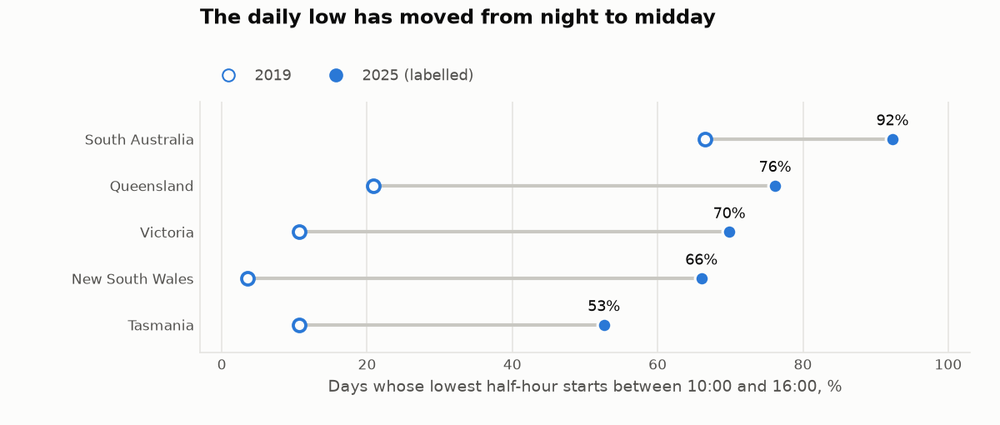
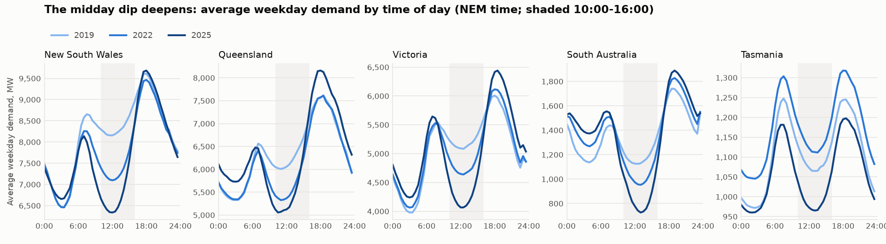
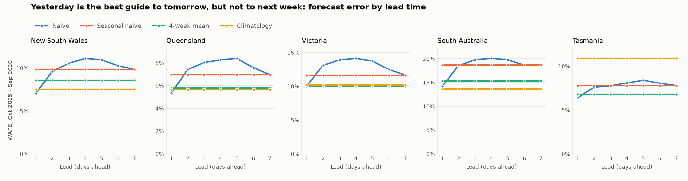
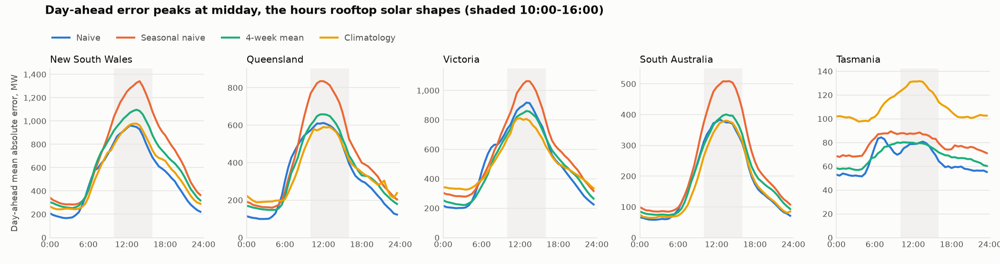
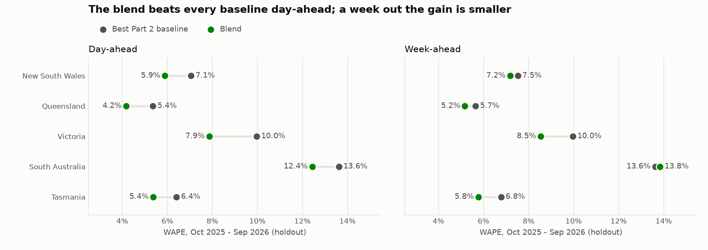

# Forecasting electricity demand for operations planning (AEMO, 5 NEM regions)

**Status: in progress. Parts 1-2 of 5 and the first half of Part 3 are done (data source and profile; baseline backtest; calendar, smoothing and level correction). Next: weather.**

How well can **simple, explainable forecasting methods** predict tomorrow's and next week's
half-hourly electricity demand in Australia's National Electricity Market (NEM)? And how much
buffer does a planner need to hold for the error that's left over?

The question matters to anyone who buys, schedules or plans around demand: an energy retailer
hedging next week's load, a network or battery operator choosing when to charge and when to do
maintenance, or a large site deciding when to run flexible equipment. These teams need a forecast
they can **explain and trust**, which is why this project sticks to baselines and classic
smoothing (seasonal naive, exponential smoothing) rather than black-box models, and measures
exactly how good they are.

## Data

| | |
|---|---|
| **Source** | Australian Energy Market Operator (AEMO), [Aggregated price and demand data](https://aemo.com.au/energy-systems/electricity/national-electricity-market-nem/data-nem/aggregated-data) |
| **Licence** | AEMO's [copyright permissions](https://www.aemo.com.au/privacy-and-legal-notices/copyright-permissions): "general permission for anyone to use AEMO Material for any purpose", with attribution to AEMO as author |
| **Coverage** | 5 regions (NSW, Queensland, Victoria, South Australia, Tasmania), Jan 2019 - Sep 2026 |
| **Raw files** | 465 monthly CSVs (127 MB), 30-minute rows to Sep 2021, then 5-minute rows; each SHA-256 pinned in [`data/raw_manifest.json`](data/raw_manifest.json) |
| **Committed snapshot** | [`data/demand_halfhourly.csv.gz`](data/demand_halfhourly.csv.gz): 679,200 half-hours (6.7 MB), described in [`data/SNAPSHOT.json`](data/SNAPSHOT.json) |
| **Public holidays** | [`data/public_holidays.csv`](data/public_holidays.csv), 2019-2026, from the open-source [`holidays`](https://github.com/vacanza/holidays) package (MIT, version pinned). Checked against the [official list](https://data.gov.au/data/dataset/australian-holidays-machine-readable-dataset) (data.gov.au, CC BY 3.0 AU), kept in [`data/official_holidays_2019_2025.csv`](data/official_holidays_2019_2025.csv) |

**Demand** here is AEMO's *operational demand* (`TOTALDEMAND`, MW): what the grid supplies, net
of rooftop solar. **Times** are NEM time (AEST, UTC+10, all year, no daylight saving), stamped
at the end of each interval. The 5-minute rows from Oct 2021 are averaged into half-hours so the
whole series has one grain.

## Part 1: is the data fit to forecast from, and what must a forecast capture?

Full generated report: [`results/SOURCE_PROFILE.md`](results/SOURCE_PROFILE.md).

**The data is complete.** All 465 files match their pinned hashes. Every region has all
135,840 half-hours from Jan 2019 to Sep 2026, with no gaps, no duplicates and no short
half-hours after the switch to five-minute settlement. The forecasts won't need any imputation.

**The shape of the day has changed more than its size.** Annual energy moved by only -5.9% to
+1.8% per region between 2019 and 2025. Over the same years, the year's lowest half-hour fell
in every region (Victoria: 3,058 MW to 1,244 MW, down 59%). South Australia's went **below zero**:
-284 MW in 2025, when rooftop solar and other small generation more than covered the state's own
use. In 2025 the lowest half-hour of the year came at midday in all 5 regions.



Victoria's daily low now falls at midday on 70% of days, up from 11% in 2019. In South
Australia it's 92%.



**Three cycles, two seasons.** Weekend demand runs 3-10% below weekdays. Average daily peaks are
higher in winter in 4 of 5 regions (all but Queensland), but on the mainland the single highest
half-hour of the year fell in Dec-Mar in 26 of 28 region-years.

**So what for the business?**
- A forecast that only targets the evening peak is now half a forecast. The **midday trough** is a
  planning problem too: it's when prices go negative (51-68% of each region's negative-price
  half-hours in 2025 fell between 10:00 and 16:00) and when batteries, flexible loads and
  minimum-demand security limits are being managed.
- Because the shape is drifting year by year, **recent history is worth more than old history**.
  That favours methods that adapt (seasonal naive, exponential smoothing) over long-run averages.
  Part 2 tests that rather than assuming it.
- Any method has to handle time of day, day of week and season at once, so those are the minimum
  bar for every baseline in the backtest.

## Part 2: how good is a forecast anyone can explain?

Full generated report: [`results/BACKTEST.md`](results/BACKTEST.md); every number for every
region, method, lead and window is in [`results/backtest_metrics.csv`](results/backtest_metrics.csv).

**Setup.** A rolling-origin backtest: every day from 1 Oct 2025 to 30 Sep 2026 (365 days, all
seasons) in all 5 regions is forecast 1 to 7 days ahead, from origins at midnight that know nothing
after them. Each method only ever gets the history up to its origin, so it can't peek at the answer.
Four baselines, none using weather:

| Method | Forecast for a target day |
|---|---|
| Naive | the last full day seen ("tomorrow = today") |
| Seasonal naive | the same weekday one week earlier |
| 4-week mean | the same weekday averaged over the last 4 weeks |
| 3-year climatology | the same weekday within ±3 weeks of the date, in each of the previous 3 years |

Accuracy is measured by **WAPE** (total absolute error / total demand), with MAE, bias and daily
peak and trough error in MW alongside. MAPE is left out on purpose: South Australia's demand nears
and crosses zero at midday, which pushes its MAPE to 704-1124% while its WAPE is 13.6-18.7%.

**Day-ahead, yesterday beats last week.** Naive is the best day-ahead baseline in 3 of 5 regions
(NSW 7.1%, Queensland 5.4%, Tasmania 6.4% WAPE); the 4-week mean wins in Victoria (10.0%) and
climatology in South Australia (13.6%). The textbook seasonal naive comes last in 4 of 5, and
swapping last week for yesterday cuts day-ahead error by 13-28%. The likeliest reason is weather:
yesterday's is a far better guide to tomorrow's than last week's.

**Week-ahead, averages win.** Persistence decays fast: from 2 days ahead, naive isn't the best method
in any region. Over a whole week, the 3-year climatology is best in NSW, Queensland and South
Australia, and the 4-week mean in Victoria and Tasmania. Averaging many similar days washes out
one-off weather. This partly overturns Part 1's guess that recent history beats long-run averages:
it holds for tomorrow, but for next week a 3-year average does better in 3 of 5 regions.



**The error lives at midday.** On the mainland, 40-49% of the best method's day-ahead error falls
between 10:00 and 16:00, a quarter of the day, where half-hours miss by 2.0-2.8× as much as the rest.
South Australia, with the deepest solar dip, is the most midday-heavy (2.8×); Tasmania, with the
shallowest, is the flattest (1.2×). That fits rooftop solar: cloud decides how much demand the grid
sees at noon, and no baseline knows tomorrow's cloud.



**Calendar and level effects.** Naive's Monday and Saturday error is 1.2-1.7× its midweek error,
because it forecasts a Monday from a Sunday. Christmas Day is among the three worst days in 4 of 5
regions. Climatology carries any shift in a region's level straight into the forecast: in the latest
year it under-forecast Victoria by 258 MW (5.1% of average demand) and over-forecast Tasmania by
104 MW (10.2%). Re-run on the year before (Oct 2024 - Sep 2025), the best method is the same in 7 of
10 region-horizon pairs, so the ranking is fairly stable but not fixed.

**So what for the business?**
- **Pick the baseline by horizon, not by habit.** A planner scheduling tomorrow should start from
  today's load; one planning next week should start from an average of similar days. The usual
  "same day last week" default is the worst day-ahead choice in 4 of 5 regions and isn't the best at
  either horizon in any region.
- **Size buffers for the midday trough, not only the evening peak.** That's where today's simple
  forecasts miss the most, and where negative prices and minimum-demand limits sit (Part 1).
- **Free wins first.** A day-type rule (yesterday midweek, last week after the weekend changes shape)
  and a holiday calendar target the misses above at no cost to explainability. Part 3 measures how
  much they actually save.
- **The bar for Part 3** is set per region and horizon (table in section 7 of the report): any
  smoothing or weather-adjusted method has to beat, for example, 7.1% day-ahead in NSW and 13.6% in
  South Australia to be worth its extra complexity.

## Part 3: what does a calendar and smoothing add, before any weather?

Full generated report: [`results/IMPROVEMENTS.md`](results/IMPROVEMENTS.md); every number is in
[`results/improvement_metrics.csv`](results/improvement_metrics.csv).

**A fair contest.** Everything was chosen on the tuning year (Oct 2024 - Sep 2025), and the latest year
(Oct 2025 - Sep 2026) was held out and only scored. The bar is the best Part 2 baseline in each region, picked
on the holdout itself, which flatters the baselines. Three caveats are stated up front. One bug was fixed after the
first holdout run: the weekday rule's Tuesday was copying Friday instead of Monday. That changed only that
method's numbers, and it isn't in the blend. Part 2 had already reported baselines on the same year, so its findings
shaped what was tried here, even though the settings and the blend were fixed without the holdout. And
the holiday dates for 2026 were checked against official lists for NSW and Queensland only.

| Method | Idea |
|---|---|
| Weekday rule | Part 2's free fix: yesterday midweek, last week on Mondays and Saturdays, a holiday treated as a weekend day |
| Holt-Winters | exponential smoothing of each half-hour with a weekly season; skips holidays, and reads a holiday as a Sunday |
| Corrected climatology | the 3-year climatology plus its mean miss per half-hour over the last 28 days |
| Blend | half Holt-Winters, half corrected climatology, the same recipe at every lead |

**Day-ahead, the blend wins everywhere.** It's the best method in all 5 regions and cuts error against the bar
by 9-22%, with every 95% interval clear of zero:

| Region | Bar | Blend | Cut | MW saved per half-hour |
|---|---:|---:|---:|---:|
| New South Wales | Naive, 7.1% | 5.9% | 16.6% | 87 |
| Queensland | Naive, 5.4% | 4.2% | 22.1% | 73 |
| Victoria | 4-week mean, 10.0% | 7.9% | 21.2% | 106 |
| South Australia | Climatology, 13.6% | 12.4% | 8.7% | 15 |
| Tasmania | Naive, 6.4% | 5.4% | 16.2% | 10 |

**Week-ahead, it's a smaller win, and not everywhere.** The blend clearly beats the bar in Queensland (-8.4%),
Victoria (-14.4%) and Tasmania (-14.9%). In New South Wales (-4.6%) and South Australia (+1.6%) the interval
spans zero, so it can't be told apart from the bar. The corrected climatology alone is marginally
ahead of the blend in Queensland and Victoria, and plain climatology in South Australia.



**The cheap fix is a coin toss.** Part 2 expected the weekday rule to be a free win. It beats naive in only 2 of 5
regions (Queensland, Victoria) because copying a week-old day fixes the shape of the day but brings in week-old
weather: on New South Wales Saturdays its error goes from 8.7% to 11.8%. The blend gets the benefit without
that cost, because it keeps the recent level and adds a weekday offset. Its Monday and Saturday error is 22-42% below
naive's.

**A level correction rescues the long-run average.** Part 2 found climatology over-forecast Tasmania by 10.2% and
under-forecast Victoria by 5.1%. The 28-day correction takes both to within 0.1%, and cuts Tasmania's day-ahead
WAPE from 10.9% to 5.7%.

**A holiday calendar fixes bad days, not the year.** On holidays it cuts Holt-Winters' error by 32% in South Australia and
28% in Victoria, but by only 4-6% in Queensland and Tasmania, and New South Wales gets 1% worse. Across all days it
moves WAPE by -0.18 to +0.04 points. Five of the blend's 15 worst days fall between 27 and 31 December, the shutdown
between Christmas and New Year, which a public-holiday calendar doesn't cover.

**Midday is still the gap.** After the blend, 43-50% of mainland day-ahead error sits between 10:00 and 16:00, and only
29-40% of the MW saved came from those hours.

**So what for the business?**
- **Use one recipe.** Half smoothed recent demand, half corrected long-run average needs only past demand and a
  calendar, and a planner can see why every number came out as it did. In Victoria that's 106 MW less error in an
  average half-hour, before buying any weather data.
- **Adjust for the weekday; don't swap to an older day.** The obvious rule beat doing nothing in only 2 of 5 regions.
- **Put a recent-level correction on any long-run average.** It's simple arithmetic and removes most of the bias.
- **Judge a holiday calendar on the holidays.** It won't move a yearly accuracy figure, and it needs a Christmas
  shutdown period added to reach the worst days.
- **The next gain has to come from the middle of the day**, which is where the weather step comes in. The blend's
  scores are now its bar (section 8 of the report).

## Plan

| Part | What | Status |
|---|---|---|
| 1 | Pinned AEMO download, half-hourly snapshot, source profile | ✅ done |
| 2 | Rolling-origin backtest harness; naive, seasonal-naive, 4-week-mean and climatology baselines; day-ahead and week-ahead error (WAPE, MAE, bias, peak and trough error) | ✅ done |
| 3 | Weekday rule, holiday calendar, Holt-Winters, corrected climatology and a blend, tuned on one year and scored on the next | ✅ done |
| 3b | A simple, explainable temperature adjustment from free public weather data, using forecasts rather than actuals | next |
| 4 | Business translation: how many MW of buffer cover 90% / 95% of days, which regions and seasons are hardest, recommendations | |
| 5 | CI, TL;DR and final write-up | |

## How to run

```bash
python -m venv .venv && source .venv/bin/activate
pip install -r requirements.txt        # or requirements-lock.txt for the exact tested versions

python -m scripts.profile              # Part 1: source profile report + charts
python -m scripts.backtest             # Part 2: backtest report, metrics CSV + charts (~20 s)
python -m scripts.improve              # Part 3: tuning, holdout report, metrics CSV + charts (~80 s)
pytest                                 # 99 tests (~2.5 min)

# optional: rebuild the snapshot from AEMO's raw files (~127 MB download)
python -m scripts.download_data        # fetches data/raw/, checks every pinned SHA-256
python -m scripts.build_snapshot       # rewrites data/demand_halfhourly.csv.gz byte for byte

# optional: rebuild the holiday calendar (--official also re-downloads the pinned check file)
python -m scripts.build_holidays
```

`download_data --pin` records hashes only for files that have none yet (e.g. after moving
`LAST_MONTH` in `demand/source.py` forward). A file that no longer matches its pinned hash stops
the run instead of silently changing the numbers.

## Tests

- **Parsing and roll-up** (`tests/test_halfhour.py`): hand-worked 5-minute rows average into the
  half-hour they end in; midnight on the 1st belongs to the previous month's file; rows from the
  wrong month or region and wrong headers are rejected; exact duplicates are dropped, conflicting
  ones fail.
- **Snapshot** (`tests/test_snapshot.py`): hash and row count match `SNAPSHOT.json`; every region
  has every half-hour exactly once; the resolution switches on 1 Oct 2021; raw row counts add up;
  a rebuild from the raw files is byte-identical (skipped if they aren't downloaded).
- **Profile** (`tests/test_profile.py`): the committed report and charts match a fresh run, and
  the headline numbers (energy, midday-minimum share, weekend effect, South Australia's negative
  minimum) are recounted independently in pandas.
- **Backtest harness** (`tests/test_backtest.py`): hand-made series with known answers. A series that
  repeats every week is forecast exactly by the weekly methods; on a straight-line trend the naive
  bias is exactly -10 MW per day of lead; each method picks the days it says; replacing everything
  after the origin with garbage doesn't change any forecast (no look-ahead); a short history raises
  instead of wrapping around; every metric is checked on a hand-worked two-day example.
- **Backtest report** (`tests/test_backtest_report.py`): the committed report, CSV and charts match
  a fresh run; seasonal naive, naive at leads 1 and 4, climatology and the 4-week mean are recounted
  with plain pandas shifts on the snapshot (no harness code), and the headline winners follow from the
  metrics. Six deliberate bugs (an off-by-one week, a leaked target day, signed instead of absolute
  demand in WAPE, a slot shifted by one half-hour, a narrower climatology window, peak used in place of
  trough) are each caught.
- **Holiday calendar** (`tests/test_holidays.py`): the committed calendar matches a fresh build; known holidays
  are in and known non-holidays are out; all 49 differences from the official list for 2019-2025 have a stated
  reason, and an unexplained one fails.
- **Part 3 methods** (`tests/test_improved.py`): hand-made series with known answers. Holt-Winters is checked by
  hand, is exact on a repeating week, and matches `statsmodels` on level, trend and leads 1-6 with the same settings.
  (At lead 7, `statsmodels` reads the season from before the last update, where the textbook formula and this code
  read the updated one; a hand-worked test covers that lead.) The level correction recovers a known shift per
  half-hour, holidays stay out of the state and the correction, and spoiling everything after the origin changes nothing.
- **Part 3 report** (`tests/test_improvements_report.py`): outputs match a fresh run; spoiling the holdout leaves the
  tuned settings unchanged; the blend's holdout WAPE is recounted in plain Python with no project code; the weekday
  rule equals naive on ordinary midweek days; baselines match Part 2's file; the interval resamples whole weeks. 15
  deliberate bugs, including the real Tuesday one, are each caught.

## Layout

```
demand/source.py          regions, months, file names, paths
demand/halfhour.py        parse a raw file, roll 5-minute rows into half-hours
scripts/download_data.py  fetch + verify the raw files
scripts/build_snapshot.py raw files -> data/demand_halfhourly.csv.gz + SNAPSHOT.json
scripts/profile.py        DuckDB SQL -> results/SOURCE_PROFILE.md + charts
demand/backtest.py        day matrix, the four baselines, rolling-origin forecasts, metrics
scripts/backtest.py       backtest -> results/BACKTEST.md, backtest_metrics.csv + charts
scripts/build_holidays.py holiday calendar + its reconciliation with the official list
demand/improved.py        weekday rule, Holt-Winters, corrected climatology, blend, tuning grid
scripts/improve.py        tune -> holdout -> results/IMPROVEMENTS.md, metrics, settings + charts
tests/                    pytest
```

*Data: © AEMO, used under AEMO's copyright permissions with attribution. Public holidays: `holidays` package (MIT),
checked against the Australian Public Holidays Dates Machine Readable Dataset, data.gov.au, CC BY 3.0 AU.*
