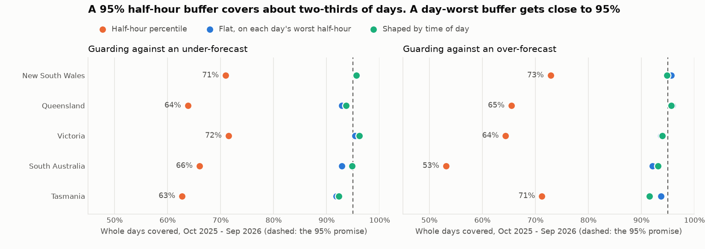
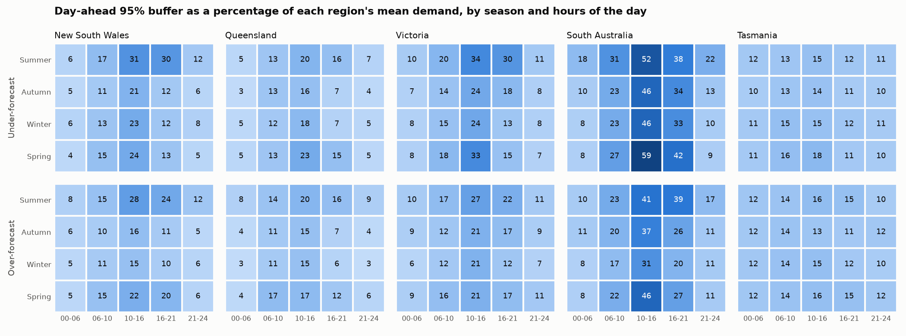
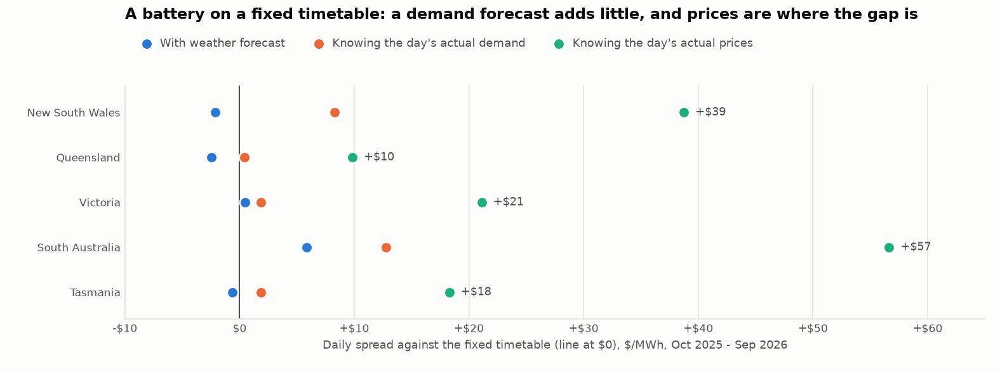

# From forecast error to MW of buffer, dollars and a battery timetable

*Generated by `scripts/buffers.py` from `data/demand_halfhourly.csv.gz`, `data/public_holidays.csv`, `data/weather_forecasts.csv.gz` and the settings
Parts 3 and 3b chose. Do not edit by hand. Every buffer is in [`buffers.csv`](buffers.csv) and every test in [`buffer_coverage.csv`](buffer_coverage.csv).*

## 1. Setup

The forecast is the Part 3b method, unchanged: blend plus archived weather forecast, issued at midnight. A **miss** is actual
minus forecast, so a positive miss is an under-forecast.

A **buffer** is MW held on one side of the forecast. *Up* guards against under-forecasting (short, buying at spot),
*down* against over-forecasting (long, selling at spot). A **day is covered** if no half-hour in it goes past the buffer. That's
the promise a planner needs, because one bad half-hour is enough to breach a limit or a position.

**Set first, tested after.** Buffers are set on 2024-12-01 to 2025-09-30 and tested on the holdout, 2025-10-01 to 2026-09-30.
October and November 2024 stay out for the same reason as in Part 3b: those fits had seen only winter. So the setting window holds
only one month of spring, and the seasonal recipes are thin there.

**The buffer is a rank, not an average.** It's the value at rank ceil((n + 1) × level) of the past days, which is one step more
careful than a plain percentile, so a small sample doesn't promise more than it has seen.

Time blocks: 00:00-06:00, 06:00-10:00, 10:00-16:00, 16:00-21:00, 21:00-24:00. Seasons: summer is December to February, and so on. *Week-ahead* pools leads 1 to 7, as in Parts 2 to 3b.

**How the holdout was used.** An early look compared half-hour and day-worst percentiles on both windows. After that the recipes
below were fixed, and all of them are shown. The yesterday's-prices rule in section 8 was added after the first battery comparison,
because that comparison raised the question of what to use instead. No recipe was dropped or changed after being scored.

| Recipe | What it is |
|---|---|
| Half-hour percentile | one MW figure: the shortcut, the 95th percentile of all half-hours |
| Flat | one MW figure: the 95th percentile of each day's worst half-hour |
| By time of day | one figure per block, each block's own promise |
| By season and time of day | one figure per season and block, each cell's own promise |
| Shaped | by time of day, stretched by one factor until the whole day meets the promise |
| Shaped by season | by season and time of day, stretched the same way |

## 2. A buffer set in advance, tested on the next year

Day-ahead, promise 95%, over 5 regions and both sides (10 tests per recipe):

| Recipe | Mean size, flat = 100% | Whole days covered (mean) | Range | Blocks covered (mean) |
|---|---:|---:|---:|---:|
| Half-hour percentile | 49% | 66.2% | 53.2%-72.9% | 88.6% |
| Flat | 100% | 93.9% | 91.8%-95.9% | 98.4% |
| By time of day | 64% | 84.8% | 80.3%-88.2% | 94.9% |
| By season and time of day | 68% | 85.8% | 82.2%-88.5% | 95.7% |
| Shaped | 87% | 94.2% | 91.5%-96.2% | 98.4% |
| Shaped by season | 81% | 92.1% | 88.8%-94.8% | 97.8% |

**The half-hour shortcut breaks its promise.** A buffer at the 95th percentile of half-hours covers only 66% of days on average
(53%-73%), because a day has 48 chances to miss. Sizing on each day's worst half-hour gives 93.9%, with a
buffer 2.0× as large. That's a little short of the promise, so read it as roughly 94%, not a guarantee.

**Sizing by time of day works, as long as it's stretched.** Giving each block its own 95% keeps that promise for the block (94.9% on
average), but with five blocks the whole day falls to 84.8%. The shaped recipe fixes that with one stretch factor. It covers 94.2% of days,
level with flat, on a buffer 3%-21% smaller across the day, or 124-9,743 MW-hours less cover to hold per day. It holds more than flat at midday and
much less overnight.

**The all-year promise is uneven.** Whole days covered, by season of the holdout (mean of the 10 tests):

| Recipe | Summer | Autumn | Winter | Spring |
|---|---:|---:|---:|---:|
| Flat | 90.8% | 96.5% | 96.3% | 92.1% |
| Shaped | 88.6% | 97.5% | 97.6% | 92.9% |
| Shaped by season | 92.4% | 93.8% | 94.1% | 88.0% |

An all-year buffer averages close to its promise, but it runs thin in summer (88.6% for shaped) and thick in autumn and winter. Shaped by season evens that out at
81% of flat's size, with 92.1% overall. Its weak spot is spring, at 88.0%, the one season it learned from only 30 days of. So the seasonal recipe isn't
proven yet, though it's closer than the headline suggests.

Flat and shaped by region, set before the holdout and tested on it. The interval is a 95% range from resampling whole weeks:

| Region | Side | Flat, MW | Days covered | Shaped, mean MW | Days covered | 95% interval |
|---|---:|---:|---:|---:|---:|---:|
| New South Wales | up | 1,977 | 95.6% | 1,571 | 95.6% | 91.2%-98.9% |
| New South Wales | down | 1,658 | 95.6% | 1,533 | 94.8% | 90.1%-98.6% |
| Queensland | up | 1,094 | 92.9% | 920 | 93.7% | 88.8%-97.5% |
| Queensland | down | 1,113 | 95.9% | 1,002 | 95.6% | 90.7%-99.5% |
| Victoria | up | 1,561 | 95.3% | 1,264 | 96.2% | 91.8%-99.5% |
| Victoria | down | 1,123 | 93.7% | 955 | 94.0% | 89.3%-97.5% |
| South Australia | up | 613 | 92.9% | 527 | 94.8% | 90.1%-98.6% |
| South Australia | down | 468 | 92.1% | 378 | 93.2% | 88.2%-97.3% |
| Tasmania | up | 162 | 91.8% | 155 | 92.3% | 87.4%-96.4% |
| Tasmania | down | 170 | 93.7% | 165 | 91.5% | 86.8%-95.6% |

The 95% promise sits inside the interval in 10 of 10 tests of the shaped recipe.

## 3. What to carry forward

Set on all 669 days from 2024-12-01 to 2026-09-30, now that the recipe has passed its test. These have no later year to be tested on.
Day-ahead, shaped, 95% of whole days, MW either side of the forecast:

| Region | Side | 00:00-06:00 | 06:00-10:00 | 10:00-16:00 | 16:00-21:00 | 21:00-24:00 | Flat |
|---|---:|---:|---:|---:|---:|---:|---:|
| New South Wales | up | 582 | 1,394 | 2,641 | 1,866 | 790 | 1,963 |
| New South Wales | down | 704 | 1,368 | 2,328 | 1,840 | 823 | 1,636 |
| Queensland | up | 414 | 1,085 | 1,656 | 993 | 464 | 1,155 |
| Queensland | down | 441 | 1,231 | 1,652 | 1,097 | 543 | 1,089 |
| Victoria | up | 577 | 1,146 | 2,111 | 1,376 | 623 | 1,547 |
| Victoria | down | 573 | 901 | 1,457 | 1,136 | 595 | 1,145 |
| South Australia | up | 206 | 501 | 947 | 665 | 252 | 661 |
| South Australia | down | 170 | 384 | 742 | 525 | 233 | 533 |
| Tasmania | up | 144 | 176 | 197 | 156 | 140 | 169 |
| Tasmania | down | 158 | 181 | 203 | 167 | 143 | 176 |

On the mainland the midday buffer is 2.5×-4.6× the overnight one. In Tasmania it's 1.3×-1.4×.

Flat buffers at both levels, for both horizons. *Share* is the day-ahead 95% buffer as a share of the region's mean demand:

| Region | Side | Day-ahead 90% | Day-ahead 95% | Week-ahead 90% | Week-ahead 95% | Share |
|---|---:|---:|---:|---:|---:|---:|
| New South Wales | up | 1,556 | 1,963 | 1,786 | 2,333 | 26% |
| New South Wales | down | 1,334 | 1,636 | 1,722 | 2,108 | 22% |
| Queensland | up | 955 | 1,155 | 1,175 | 1,482 | 19% |
| Queensland | down | 902 | 1,089 | 1,140 | 1,359 | 18% |
| Victoria | up | 1,144 | 1,547 | 1,388 | 1,774 | 31% |
| Victoria | down | 1,016 | 1,145 | 1,279 | 1,497 | 23% |
| South Australia | up | 538 | 661 | 632 | 799 | 50% |
| South Australia | down | 410 | 533 | 550 | 660 | 40% |
| Tasmania | up | 144 | 169 | 160 | 188 | 16% |
| Tasmania | down | 145 | 176 | 161 | 191 | 17% |

Looking a week out adds 8%-31% to the 95% buffer. Under-forecasts are the larger side in New South Wales, Victoria and South Australia
(1.20×-1.35× the over-forecast buffer), and the two sides are nearly equal in Queensland and Tasmania (0.96×-1.06×).
Every buffer, including the seasonal ones and the 90% level, is in [`buffers.csv`](buffers.csv).

## 4. Which seasons and hours are hardest?

Each cell below is that season and block's own 95% day-ahead buffer, on the days from 2024-12-01 on, as a share of the region's mean demand so
regions can be compared. It maps where the risk sits. It isn't a whole-day promise, and section 2 shows that a seasonal buffer has yet to prove itself.

The hardest cell for each region and side:

| Region | Side | Hardest cell | Buffer, MW | Share of mean demand |
|---|---:|---:|---:|---:|
| New South Wales | up | Summer, 10:00-16:00 | 2,349 | 31% |
| New South Wales | down | Summer, 10:00-16:00 | 2,092 | 28% |
| Queensland | up | Spring, 10:00-16:00 | 1,449 | 23% |
| Queensland | down | Summer, 10:00-16:00 | 1,221 | 20% |
| Victoria | up | Summer, 10:00-16:00 | 1,694 | 34% |
| Victoria | down | Summer, 10:00-16:00 | 1,332 | 27% |
| South Australia | up | Spring, 10:00-16:00 | 794 | 59% |
| South Australia | down | Spring, 10:00-16:00 | 613 | 46% |
| Tasmania | up | Spring, 10:00-16:00 | 191 | 18% |
| Tasmania | down | Summer, 10:00-16:00 | 172 | 16% |

The hardest cell is the 10:00-16:00 block in 10 of 10 cases. Spring rests on 121 days, the other seasons on 180-184.

## 5. What the better forecast saved

The same flat 95% promise on the holdout's own days, changing only the forecast (up / down, MW):

| Region | Same day last week | Blend (Part 3) | With weather (Part 3b) |
|---|---:|---:|---:|
| New South Wales | 3,827 / 3,617 | 2,876 / 1,978 | 1,963 / 1,606 |
| Queensland | 2,214 / 2,189 | 1,679 / 1,322 | 1,243 / 1,089 |
| Victoria | 2,684 / 2,738 | 1,991 / 1,531 | 1,547 / 1,212 |
| South Australia | 1,259 / 1,318 | 984 / 639 | 709 / 580 |
| Tasmania | 270 / 267 | 202 / 192 | 173 / 186 |

Against the usual "same day last week", the weather method cuts the buffer by 30%-56%. Against the blend it cuts 3%-32%. These figures are hindsight, for comparing
forecasts: each is the buffer that would have fitted that year.

## 6. When a buffer fails, and how far

Every holdout day past the flat 95% buffer set beforehand:

| Region | Side | Buffer, MW | Days past it | In summer | Holiday or 27-31 Dec | Worst miss, MW | On |
|---|---:|---:|---:|---:|---:|---:|---:|
| New South Wales | up | 1,977 | 16 | 9 | 1 | 4,460 | Fri 19 Dec 2025 |
| New South Wales | down | 1,658 | 16 | 9 | 4 | 3,040 | Mon 02 Feb 2026 |
| Queensland | up | 1,094 | 26 | 6 | 1 | 2,176 | Fri 31 Oct 2025 |
| Queensland | down | 1,113 | 15 | 6 | 1 | 1,670 | Sat 15 Nov 2025 |
| Victoria | up | 1,561 | 17 | 8 | 0 | 2,924 | Sun 26 Oct 2025 |
| Victoria | down | 1,123 | 23 | 11 | 2 | 1,546 | Tue 01 Sep 2026 |
| South Australia | up | 613 | 26 | 8 | 0 | 1,122 | Sun 02 Nov 2025 |
| South Australia | down | 468 | 29 | 11 | 2 | 861 | Tue 18 Nov 2025 |
| Tasmania | up | 162 | 30 | 9 | 0 | 258 | Wed 07 Jan 2026 |
| Tasmania | down | 170 | 23 | 6 | 3 | 292 | Wed 26 Aug 2026 |

**A buffer is a limit on how often, not how far.** The worst miss of the year was 1.4×-2.3× the buffer. A planner still needs a plan for those days.

**Most breaches fall on ordinary days.** Holidays and 27-31 December are 14 of 221 breaches (6%), against 4% of the year's days.
They're the worst days in percentage terms (Part 3b) but not the main reason a buffer is breached. Summer brings 38% of breaches, on 25% of days.

**Regions don't all miss at once.** Across the 5 regions, the sum of their own buffers is 5,496 MW up and 4,579 MW down. A single buffer on their combined miss, for the same
promise, needs 3,014 and 2,848 MW: 45% and 38% less. That's an upper limit for a multi-region book, since it ignores interconnector limits.

## 7. What the error costs at spot

A retailer hedges its forecast at a fixed price and settles the difference at spot. Compared with a perfect forecast, each half-hour costs
*miss × (spot price - hedge price) × half an hour*, so being short into a high price costs money, and so does being long into a low one.
This takes a retailer with 1% of its region's load, whose misses are 1% of the region's, hedged at the year's mean spot price. Day-ahead, holdout year:

| Region | Same day last week | Blend | With weather | With weather, per MWh of load | Saved by weather on the blend | 95% interval |
|---|---:|---:|---:|---:|---:|---:|
| New South Wales | $2.66m | $1.95m | $1.28m | $1.97 | $672k | $272k to $1.28m |
| Queensland | $659k | $503k | $318k | $0.59 | $185k | $105k to $271k |
| Victoria | $1.49m | $1.25m | $652k | $1.48 | $601k | $342k to $935k |
| South Australia | $1.41m | $1.15m | $356k | $3.13 | $796k | $190k to $2.00m |
| Tasmania | $96k | $71k | $66k | $0.74 | $5k | -$1k to $12k |

**The cost falls faster than the error.** Weather cuts this cost by 8%-69% on the blend, more than its WAPE cut in 5 of 5 regions (7%-32%),
so the misses it removes were worth more than the average miss. The saving is clear of zero in 4 of 5 regions (New South Wales, Queensland, Victoria, South Australia). The intervals are wide, because a few half-hours decide the year.

Where the with-weather cost sits:

| Region | Half-hours above $300 | Cost in those half-hours | Cost at negative prices | Cost at all other prices |
|---|---:|---:|---:|---:|
| New South Wales | 54 | 63% | 16% | 21% |
| Queensland | 12 | 0% | 55% | 45% |
| Victoria | 34 | 6% | 41% | 52% |
| South Australia | 245 | 61% | 27% | 12% |
| Tasmania | 26 | 15% | 12% | 73% |

**The right cover differs by region.** $300/MWh is the level of ASX's $300 cap futures, so it's used here as the line for a high price. In New South Wales and South Australia the half-hours above it hold 63% and 61% of the
cost, and in New South Wales that's just 54 of 17,520 half-hours, so a cap is aimed at the right place. In Queensland and Victoria they hold 0% and 6%, while negative-price half-hours hold
55% and 41%. A cap pays on high prices, so it doesn't touch those.

Week-ahead, the with-weather cost is 17%-69% higher than day-ahead.

## 8. Can the forecast time a battery?

A 100 MW / 400 MWh battery charges for 4 hours and discharges for 4 hours once a day, committed at midnight. Each rule picks the two windows and earns that day's actual prices. The
figures are the mean **spread** in $/MWh, discharge price minus charge price, before losses, for a price-taker. Demand stands in for price: charge when demand looks lowest, discharge when it looks highest.

The fixed timetable is the best pair of windows on average prices before the holdout, used every day:

| Region | Charge | Discharge |
|---|---:|---:|
| New South Wales | 09:30-13:30 | 16:30-20:30 |
| Queensland | 09:30-13:30 | 16:30-20:30 |
| Victoria | 10:30-14:30 | 17:00-21:00 |
| South Australia | 10:00-14:00 | 17:00-21:00 |
| Tasmania | 11:00-15:00 | 17:00-21:00 |

Holdout spreads. The last two columns know the day's actuals, so they're ceilings, not results:

| Region | Fixed timetable | Same day last week | Blend | With weather | Yesterday's prices | Actual demand | Actual price |
|---|---:|---:|---:|---:|---:|---:|---:|
| New South Wales | $75 | $64 | $71 | $73 | $73 | $84 | $114 |
| Queensland | $87 | $81 | $86 | $85 | $83 | $88 | $97 |
| Victoria | $70 | $59 | $68 | $71 | $66 | $72 | $91 |
| South Australia | $128 | $132 | $139 | $134 | $101 | $141 | $185 |
| Tasmania | $34 | $27 | $33 | $33 | $30 | $35 | $52 |

Yearly gain on the fixed timetable for that battery, with a 95% interval from resampling whole weeks:

| Region | With weather | Actual demand (ceiling) | Actual price (ceiling) |
|---|---:|---:|---:|
| New South Wales | -$309k (-$1.05m to $705k) | $1.21m (-$271k to $3.20m) | $5.66m ($2.66m to $9.52m) |
| Queensland | -$360k (-$588k to -$148k) | $61k (-$144k to $261k) | $1.43m ($1.15m to $1.75m) |
| Victoria | $70k (-$363k to $509k) | $272k (-$209k to $759k) | $3.08m ($2.55m to $3.64m) |
| South Australia | $852k ($416k to $1.29m) | $1.86m ($540k to $4.34m) | $8.27m ($4.50m to $13.88m) |
| Tasmania | -$96k (-$437k to $281k) | $271k (-$292k to $985k) | $2.67m ($1.87m to $3.72m) |

**Outside South Australia, a demand forecast doesn't beat a timetable.** With weather, it's clearly ahead only in South Australia, clearly behind in Queensland, and can't be told apart in
New South Wales, Victoria, Tasmania. Even knowing the day's demand exactly is clearly better only in South Australia. A more accurate forecast didn't reliably help either: the blend out-earned the with-weather forecast in Queensland, South Australia, Tasmania.

**The gap is in prices, not demand.** The timetable already earns 65%-90% of the actual-price ceiling, and knowing the day's demand closes only 4%-23% of what's left.
That ceiling shows the prize, not what a real price forecast would earn. The simple price rule tested here falls short: copying yesterday's prices is clearly behind the timetable in 4 of 5 regions.

## What this means for operations planning

- **Size a buffer on each day's worst half-hour.** A half-hour percentile called 95% covered 66% of days.
- **Carry the shaped buffer.** It kept the promise as well as a flat one (94.2% against 93.9%) and held 3%-21% less. The table is in section 3.
- **Add cover in summer, and retest seasonal buffers.** The all-year buffer covered 89% of summer days and 98% of winter ones. Seasonal buffers even that out, but they aren't proven until spring has more than 30 days behind it. The seasonal figures in `buffers.csv` now have 121.
- **Plan for the breach.** The worst miss of the year was 1.4×-2.3× the buffer, so a buffer needs a fallback.
- **Net buffers across regions where the book allows.** A combined buffer was 38%-45% smaller than the sum of the regional ones.
- **Match the cover to the region.** A $300 cap is aimed at most of the cost in New South Wales and South Australia. In Queensland and Victoria 41%-55% sits in negative-price half-hours, which a cap doesn't touch.
- **Keep a battery on a timetable unless a price forecast beats it.** A better demand forecast clearly gained only in South Australia. The bigger prize is in prices, so that's the forecast to test next.

## Limits

- One setting period and one test year. The intervals cover the weeks within that year, not other years, and rooftop solar keeps growing.
- The setting period holds only September of spring, so the seasonal recipes are thin there. The carry-forward table has no later year to be tested on.
- The early look described in section 1 means the holdout isn't fully unseen, and Parts 2 to 3b had already reported on the same year.
- These are region-wide misses. A retailer's own error differs from its region's, and a large regional surprise is partly what moves the price, so section 7 overstates how
  closely a small retailer's misses line up with price. Read it as a yardstick for comparing forecasts, not as a bill.
- The hedge is a flat swap at the year's mean spot price, known only in hindsight. Real books are shaped, hedged months ahead, and carry caps, fees and losses. Day-ahead is the last step of that process.
- The battery is a price-taker with one cycle a day, no losses, no degradation, no ancillary-service income and no second cycle for the morning peak. Those would change the dollars,
  and could change the ranking of the rules. Real operators re-bid through the day rather than commit at midnight.
- The timetable is one fixed pair per region, chosen on mean prices, which a few spikes can sway.
- A few half-hours decide each year's dollar figures, so another year could look quite different. That's why the intervals are wide.
- The forecast inherits Part 3b's limits, including its free non-commercial weather source.

*Sources: Australian Energy Market Operator (AEMO), Aggregated price and demand data, used under AEMO's copyright
permissions (any purpose, with attribution to AEMO as author). Public holidays: the `holidays` Python package (MIT);
checked against the Australian Public Holidays Dates Machine Readable Dataset, data.gov.au, CC BY 3.0 AU.
[Weather data by Open-Meteo.com](https://open-meteo.com/), [CC BY 4.0](https://creativecommons.org/licenses/by/4.0/),
hourly values moved onto half-hours and turned into degrees and differences; underlying model: ECMWF IFS, CC BY 4.0.*
