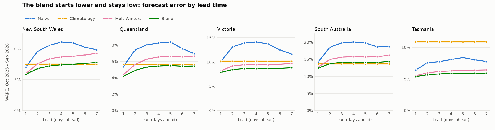

# Improving on the baselines: calendar, smoothing and level correction, no weather

*Generated by `scripts/improve.py` from `data/demand_halfhourly.csv.gz` and `data/public_holidays.csv`. Do not edit by
hand. Every region, method, lead and window is in [`improvement_metrics.csv`](improvement_metrics.csv).*

## 1. Setup

Same harness, target days, leads and metrics as [`BACKTEST.md`](BACKTEST.md), with one extra rule:
**every choice is made on the tuning year (2024-10-01 to 2025-09-30), and the holdout year (2025-10-01
to 2026-09-30) is only scored.** The recipes below, the Holt-Winters settings and the 50/50 blend were
all fixed before the holdout was first run. One bug was fixed after that run: the weekday rule's Tuesday was
copying the previous Friday instead of Monday, against the rule as Part 2 stated it. Only that method's numbers
changed, and it isn't part of the blend.

| Method | Forecast for a target day |
|---|---:|
| Weekday rule | the rule Part 2 proposed: Tue-Fri copy the last ordinary weekday (yesterday, unless it was a holiday), Monday and Saturday copy last week's, Sundays and holidays copy the last weekend day or holiday |
| Holt-Winters | exponential smoothing of each half-hour with a weekly season; skips holidays, and reads a holiday as a Sunday |
| Corrected climatology | the Part 2 climatology plus its mean miss per half-hour over the last 28 days; a holiday reads the nearest Sunday |
| Blend | half Holt-Winters (day-ahead setting), half corrected climatology, at every lead |

**Holt-Winters settings**, one pair per region for each horizon, chosen from 100
settings on the tuning year only. Alpha is how fast the level reacts to the latest day; gamma is how
fast the weekly shape can change:

| Region | Day-ahead alpha | Day-ahead gamma | Week-ahead alpha | Week-ahead gamma |
|---|---:|---:|---:|---:|
| NSW1 | 0.7 | 0.02 | 0.2 | 0.01 |
| QLD1 | 0.8 | 0.01 | 0.2 | 0.005 |
| VIC1 | 0.4 | 0.01 | 0.15 | 0.01 |
| SA1 | 0.5 | 0.01 | 0.15 | 0.02 |
| TAS1 | 0.3 | 0.01 | 0.15 | 0.01 |

The level reacts faster for tomorrow than for next week in every region, and the weekly shape changes
slowly. A damped trend was on offer and was chosen in only 2 of 10 cases. Settings at the
edge of the grid: QLD1 day (alpha 0.8), QLD1 week (gamma 0.005).

**The bar** is the best of the four Part 2 baselines in each region, picked on the holdout itself, which
flatters the baselines. **Cut** is the fall in total absolute error against that bar. The interval is a 95%
range from resampling whole weeks of the holdout (2,000 draws): it shows how much the result
depends on which weeks fell in the year, and it says nothing about future years.

## 2. The holdout result

Day-ahead WAPE, 2025-10-01 to 2026-09-30 (lowest of all methods in bold):

| Region | Bar | Weekday rule | Holt-Winters | Corrected climatology | Blend | Blend vs bar | 95% interval |
|---|---:|---:|---:|---:|---:|---:|---:|
| NSW1 | Naive, 7.1% | 7.5% | 6.0% | 7.0% | **5.9%** | -16.6% | -22.8% to -9.8% |
| QLD1 | Naive, 5.4% | 5.2% | 4.4% | 5.0% | **4.2%** | -22.1% | -28.1% to -15.3% |
| VIC1 | 4-week mean, 10.0% | 9.6% | 8.2% | 8.2% | **7.9%** | -21.2% | -27.3% to -15.3% |
| SA1 | Climatology, 13.6% | 14.4% | 12.7% | 13.5% | **12.4%** | -8.7% | -12.7% to -4.4% |
| TAS1 | Naive, 6.4% | 6.5% | 5.5% | 5.7% | **5.4%** | -16.2% | -20.9% to -10.7% |

Week-ahead WAPE (Holt-Winters with its week-ahead setting):

| Region | Bar | Weekday rule | Holt-Winters | Corrected climatology | Blend | Blend vs bar | 95% interval |
|---|---:|---:|---:|---:|---:|---:|---:|
| NSW1 | Climatology, 7.5% | 9.2% | 7.6% | 7.3% | **7.2%** | -4.6% | -10.7% to +1.3% |
| QLD1 | Climatology, 5.7% | 6.5% | 5.3% | **5.1%** | 5.2% | -8.4% | -15.0% to -0.7% |
| VIC1 | 4-week mean, 10.0% | 11.0% | 8.8% | **8.4%** | 8.5% | -14.4% | -19.8% to -9.2% |
| SA1 | Climatology, 13.6% | 17.2% | 14.2% | 13.7% | 13.8% | +1.6% | -1.2% to +4.5% |
| TAS1 | 4-week mean, 6.8% | 7.5% | 6.0% | 5.8% | **5.8%** | -14.9% | -18.4% to -10.9% |

**Day-ahead, the blend is the best method in 5 of 5 regions** and cuts error by
9%-22% against the bar, with every interval clear of zero.

**Week-ahead, the win is smaller and not universal.** The blend clears the bar, with an interval clear of zero, in
3 of 5 regions (QLD1, VIC1, TAS1). It doesn't in NSW1 (-4.6%, interval -10.7% to +1.3%) or SA1 (+1.6%, interval -1.2% to +4.5%): there the
interval spans zero, so the blend and the bar can't be told apart. The lowest week-ahead error by region:
NSW1 blend, QLD1 corrected climatology, VIC1 corrected climatology, SA1 climatology, TAS1 blend.

The day-ahead saving in MW (mean absolute error per half-hour):

| Region | Bar | Blend | Saved |
|---|---:|---:|---:|
| New South Wales | 525 | 438 | 87 |
| Queensland | 332 | 259 | 73 |
| Victoria | 500 | 394 | 106 |
| South Australia | 177 | 162 | 15 |
| Tasmania | 65 | 55 | 10 |

## 3. The cheap fix is a coin toss: the weekday rule

Part 2 suggested a free fix: keep yesterday midweek, and switch to last week on the days the week changes
shape. **It beats plain naive day-ahead in only 2 of 5 regions** (QLD1, VIC1; naive to rule:
NSW1 7.1% to 7.5%, QLD1 5.4% to 5.2%, VIC1 10.1% to 9.6%, SA1 14.2% to 14.4%, TAS1 6.4% to 6.5%). It only changes Mondays, Saturdays and days on or next to a holiday, and it beats naive in 7 of
10 of those Monday and Saturday comparisons, but its misses are large: NSW1 on Sats goes from
8.7% to 11.8%. Copying a week-old day fixes the shape of the day but brings in week-old weather.

The blend gets the benefit without that cost, because it keeps the recent level and adds a weekday offset: its
Monday and Saturday error is 22%-42% below naive's.

Day-ahead WAPE by target weekday:

| Region / method | Mon | Tue | Wed | Thu | Fri | Sat | Sun |
|---|---:|---:|---:|---:|---:|---:|---:|
| NSW1 naive | 9.4% | 6.6% | 5.7% | 6.2% | 5.3% | 8.7% | 7.7% |
| NSW1 weekday rule | 9.1% | 6.4% | 5.7% | 6.8% | 5.2% | 11.8% | 7.7% |
| NSW1 blend | 5.8% | 5.8% | 5.4% | 5.6% | 5.5% | 6.4% | 6.8% |
| QLD1 naive | 7.8% | 5.1% | 4.2% | 3.8% | 4.8% | 7.2% | 4.6% |
| QLD1 weekday rule | 7.1% | 4.8% | 4.2% | 3.8% | 4.8% | 7.0% | 4.6% |
| QLD1 blend | 4.5% | 4.6% | 3.9% | 3.8% | 4.1% | 4.3% | 4.0% |
| VIC1 naive | 13.5% | 8.9% | 9.0% | 8.3% | 7.9% | 13.2% | 10.1% |
| VIC1 weekday rule | 10.6% | 8.9% | 9.1% | 8.5% | 7.9% | 12.0% | 10.1% |
| VIC1 blend | 8.0% | 8.0% | 7.5% | 7.5% | 7.4% | 8.1% | 8.6% |
| SA1 naive | 16.2% | 13.1% | 12.5% | 12.0% | 12.4% | 17.4% | 16.3% |
| SA1 weekday rule | 15.8% | 13.2% | 12.5% | 12.5% | 12.4% | 18.4% | 16.3% |
| SA1 blend | 12.3% | 12.4% | 12.2% | 12.7% | 11.1% | 13.2% | 13.5% |
| TAS1 naive | 7.3% | 6.6% | 5.9% | 6.5% | 5.6% | 7.1% | 5.8% |
| TAS1 weekday rule | 8.1% | 6.6% | 5.9% | 6.7% | 5.5% | 6.9% | 5.8% |
| TAS1 blend | 5.7% | 5.7% | 5.8% | 5.1% | 4.6% | 5.2% | 5.5% |

## 4. Fixing the long-run average's level

Part 2 found climatology carries a shift in a region's level straight into the forecast. A 28-day
correction per half-hour takes most of that out (the holdout's day-ahead bias and WAPE):

| Region | Climatology bias | Corrected bias | Climatology WAPE | Corrected WAPE |
|---|---:|---:|---:|---:|
| NSW1 | +52 MW (+0.7%) | -12 MW (-0.2%) | 7.5% | 7.0% |
| QLD1 | -71 MW (-1.2%) | +1 MW (+0.0%) | 5.7% | 5.0% |
| VIC1 | -258 MW (-5.1%) | +0 MW (+0.0%) | 10.2% | 8.2% |
| SA1 | -10 MW (-0.8%) | +4 MW (+0.3%) | 13.6% | 13.5% |
| TAS1 | +104 MW (+10.2%) | -1 MW (-0.1%) | 10.9% | 5.7% |

TAS1 shows it best: its bias falls from +10.2% to -0.1% of average
demand, and its WAPE from 10.9% to 5.7%.

## 5. What the holiday calendar is worth

Day-ahead WAPE on public holidays only (the bar is that region's all-year best baseline), and the change the
calendar makes to Holt-Winters across all 365 days:

| Region | Holidays | Bar | Holt-Winters, no calendar | Holt-Winters | Blend | All-year effect |
|---|---:|---:|---:|---:|---:|---:|
| NSW1 | 12 | Naive, 10.2% | 9.1% | 9.2% | 8.0% | +0.04 pts |
| QLD1 | 11 | Naive, 5.6% | 6.3% | 6.1% | 5.4% | -0.01 pts |
| VIC1 | 13 | 4-week mean, 18.0% | 12.2% | 8.7% | 9.6% | -0.13 pts |
| SA1 | 12 | Climatology, 23.0% | 16.5% | 11.3% | 14.7% | -0.18 pts |
| TAS1 | 9 | Naive, 6.4% | 6.1% | 5.7% | 5.6% | -0.01 pts |

On the holidays themselves, the calendar changes Holt-Winters' error by SA1 -32%, VIC1 -28%, TAS1 -6%, QLD1 -4%, NSW1 +1%. It matters most in
SA1 and VIC1, and much less elsewhere. Over the whole year it moves WAPE by -0.18 to
+0.04 points: better in 4 of 5 regions, slightly worse in NSW1. With only
9-13 holidays a year, a calendar fixes particular bad days rather than general accuracy.

## 6. Where the remaining error sits

Day-ahead, the bar against the blend (peak and trough = mean daily error in MW):

| Region | Peak, bar | Peak, blend | Trough, bar | Trough, blend | Midday share, bar | Midday share, blend |
|---|---:|---:|---:|---:|---:|---:|
| NSW1 | 588 | 523 | 596 | 561 | 42% | 44% |
| QLD1 | 302 | 236 | 496 | 404 | 43% | 46% |
| VIC1 | 517 | 379 | 561 | 488 | 40% | 43% |
| SA1 | 147 | 130 | 326 | 299 | 49% | 50% |
| TAS1 | 60 | 54 | 54 | 56 | 29% | 28% |

The middle of the day is still the problem. After the blend, 43%-50%
of mainland day-ahead error still falls between 10:00 and 16:00, a quarter of the day, and only
29%-40% of the MW saved came from those hours. Calendar and smoothing can't know tomorrow's
cloud, which is what the weather step is for.

The three worst day-ahead days for the blend (that day's WAPE):

| Region | Worst | 2nd | 3rd |
|---|---:|---:|---:|
| NSW1 | Sat 27 Dec 2025 (32%) | Mon 02 Feb 2026 (26%) | Mon 29 Dec 2025 (23%) |
| QLD1 | Mon 29 Dec 2025 (17%) | Sat 27 Dec 2025 (16%) | Tue 02 Dec 2025 (15%) |
| VIC1 | Wed 07 Jan 2026 (31%) | Sun 11 Jan 2026 (31%) | Tue 27 Jan 2026 (28%) |
| SA1 | Sun 01 Feb 2026 (52%) | Tue 03 Mar 2026 (50%) | Wed 18 Feb 2026 (49%) |
| TAS1 | Sun 02 Nov 2025 (22%) | Mon 29 Dec 2025 (20%) | Tue 04 Nov 2025 (15%) |

5 of these 15 days fall between 27 and 31 December: the shutdown between Christmas and New Year, which
a public-holiday calendar doesn't cover.

## 7. Does it hold outside the year it was tuned on?

Blend against the best baseline of the same year:

| Region | Day-ahead, tuning year | Day-ahead, holdout | Week-ahead, tuning year | Week-ahead, holdout |
|---|---:|---:|---:|---:|
| NSW1 | -20.2% | -16.6% | -8.6% | -4.6% |
| QLD1 | -19.8% | -22.1% | -14.8% | -8.4% |
| VIC1 | -18.0% | -21.2% | -11.0% | -14.4% |
| SA1 | -10.2% | -8.7% | -3.8% | +1.6% |
| TAS1 | -16.3% | -16.2% | -14.4% | -14.9% |

The tuning-year column is in-sample, so the holdout column is the one to quote. The gain carried over in 5 of
5 regions day-ahead and 4 of 5 week-ahead.

## 8. The bar for the weather step

The blend is what a weather adjustment has to beat. It's the single recipe chosen on the tuning year, so its
holdout scores are fair. Picking the best method per region from the holdout would not be:

| Region | Day-ahead (WAPE) | Week-ahead (WAPE) | Day-ahead MAE |
|---|---:|---:|---:|
| New South Wales | 5.9% | 7.2% | 438 MW |
| Queensland | 4.2% | 5.2% | 259 MW |
| Victoria | 7.9% | 8.5% | 394 MW |
| South Australia | 12.4% | 13.8% | 162 MW |
| Tasmania | 5.4% | 5.8% | 55 MW |

## What this means for operations planning

- **Use one recipe, not a rule per horizon.** Half smoothed recent demand, half corrected long-run average cuts
  day-ahead error by 9%-22% against the best simple baseline. It needs nothing but past
  demand and a calendar, and a planner can see exactly why each number came out as it did.
- **Don't spend effort on weekday rules.** The obvious rule beats doing nothing in only 2 of 5 regions.
  Adjust for the weekday; don't swap to an older day.
- **Treat the holiday calendar as a fix for known bad days.** It matters most in SA1 and
  VIC1 and barely moves the yearly figure, so judge it on the holidays alone.
- **Keep a recent-level correction on any long-run average.** It's simple arithmetic, and it removes most of the
  bias when a region's level has moved.
- **The midday trough remains the gap.** That's where the next gain has to come from, and it needs weather.

## Limits

- One tuning year and one holdout year. The intervals cover the weeks within the holdout, not other years.
- The holdout wasn't completely unseen. Part 2 reported the baselines on the same year, and its findings (the
  level bias, the holiday misses) suggested what to try here. The settings and the blend were still fixed without it.
- The calendar's 2026 dates were checked against official lists for NSW and Queensland only. The Victorian, South
  Australian and Tasmanian pages block automated requests, so theirs rest on the `holidays` package's rules.
- The 2019-2025 dates reconcile with the official list; every difference is explained in `scripts/build_holidays.py`.
- Part-day and local holidays (Christmas Eve evening, Royal Queensland Show, Royal Hobart Regatta) are not modelled.
- No weather yet: nothing here knows a heatwave or a cloudy day is coming.

*Sources: Australian Energy Market Operator (AEMO), Aggregated price and demand data, used under AEMO's copyright
permissions (any purpose, with attribution to AEMO as author). Public holidays: the `holidays` Python package (MIT);
checked against the Australian Public Holidays Dates Machine Readable Dataset, data.gov.au, CC BY 3.0 AU.*
