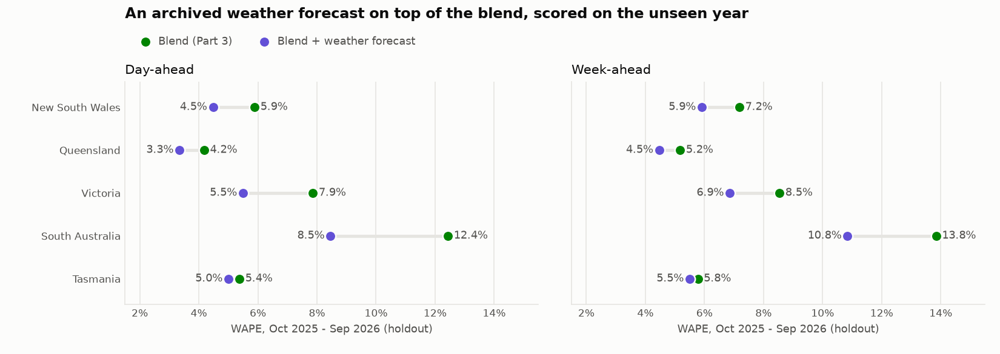
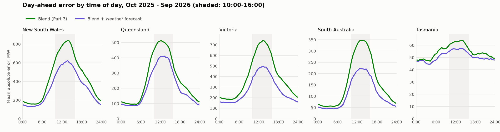

# Adding a weather forecast to the blend

*Generated by `scripts/weather.py` from `data/demand_halfhourly.csv.gz`, `data/public_holidays.csv` and
`data/weather_forecasts.csv.gz`. Do not edit by hand. Every region, method, lead and window is in
[`weather_metrics.csv`](weather_metrics.csv).*

## 1. Setup

Same harness, target days, leads and metrics as [`BACKTEST.md`](BACKTEST.md) and [`IMPROVEMENTS.md`](IMPROVEMENTS.md).
The blend and its settings come from Part 3 unchanged.

**The weather has to be a forecast.** A demand model scored on what the weather turned out to be would look far
better than anything a planner could use. So this uses Open-Meteo's Previous Runs archive, which keeps what ECMWF's
model predicted days ahead, not its stitched "historical forecast" series, which tracks what happened. A spot check
against single model runs on one day in June 2026 found `previous_day1` matching runs about 23 hours older than the hour.

**And it has to have been published.** A run takes hours to come out, so that day-old run can start before the
midnight origin yet be published after it. So the headline method reads weather one day older than its name: lead 1 uses `previous_day2`, and so on.
Lead 7 can't go older, because the archive stops there.

**The method** is one small regression per half-hour, fitted on the blend's own past misses:

    miss = intercept + a × (cooling degrees vs last week) + b × (heating degrees vs last week) + c × (sun vs last week)

Cooling degrees are how far the forecast temperature is above a threshold, heating degrees how far it's below one, and
sun is forecast solar radiation (W/m²). Each is compared with its average over the 7 days before the origin, because
the blend already reflects that weather. A small ridge penalty stops a thin fit swinging wildly. The fit is redone
monthly with a separate fit per lead, on days before the month of the origin only, and public holidays and 27-31 December are
left out of it. Weather comes from one point per region, the capital.

**Chosen on the tuning year only** (36 settings per region, day-ahead WAPE, 2024-12-01 to 2025-09-30):

| Region | Weather point | Heating below | Cooling above | Ridge penalty |
|---|---:|---:|---:|---:|
| NSW1 | Sydney | 16°C | 20°C | 30 |
| QLD1 | Brisbane | 16°C | 22°C | 30 |
| VIC1 | Melbourne | 14°C | 20°C | 30 |
| SA1 | Adelaide | 14°C | 20°C | 30 |
| TAS1 | Hobart | 14°C | 22°C | 100 |

October and November 2024 were left out of the choice. Those fits had seen only April to September, so the first hot days
were an extrapolation: even with the chosen setting, VIC1's day-ahead error in 2024-11 was +96% against the blend. That only
happens once, because by the holdout the fit has seen a summer.

**A shutdown period was tried and dropped.** Treating 27-31 December like a holiday had to lower the blend's tuning-year
WAPE in at least 3 of 5 regions to be kept. It did in 2 (VIC1, SA1), so the weather method doesn't use it.

**The bar** is the Part 3 blend. **Cut** is the fall in total absolute error against it. The interval is a 95% range from
resampling whole weeks of the holdout (2,000 draws).

## 2. The holdout result

Day-ahead WAPE, 2025-10-01 to 2026-09-30:

| Region | Blend | Weather | Cut | 95% interval |
|---|---:|---:|---:|---:|
| NSW1 | 5.9% | 4.5% | -23.9% | -27.4% to -19.9% |
| QLD1 | 4.2% | 3.3% | -20.0% | -24.4% to -15.0% |
| VIC1 | 7.9% | 5.5% | -30.1% | -34.4% to -25.4% |
| SA1 | 12.4% | 8.5% | -32.0% | -36.7% to -26.8% |
| TAS1 | 5.4% | 5.0% | -6.9% | -9.4% to -4.3% |

Week-ahead WAPE:

| Region | Blend | Weather | Cut | 95% interval |
|---|---:|---:|---:|---:|
| NSW1 | 7.2% | 5.9% | -17.7% | -21.0% to -14.2% |
| QLD1 | 5.2% | 4.5% | -13.6% | -17.6% to -9.2% |
| VIC1 | 8.5% | 6.9% | -19.7% | -23.6% to -15.6% |
| SA1 | 13.8% | 10.8% | -21.7% | -26.2% to -16.6% |
| TAS1 | 5.8% | 5.5% | -4.8% | -7.1% to -2.4% |

**Day-ahead:** 5 of 5 regions clear of zero (NSW1, QLD1, VIC1, SA1, TAS1). The largest cut is SA1 (-32.0%), the smallest TAS1 (-6.9%).

**Week-ahead:** 5 of 5 regions clear of zero (NSW1, QLD1, VIC1, SA1, TAS1).

The day-ahead saving in MW (mean absolute error per half-hour):

| Region | Blend | Weather | Saved |
|---|---:|---:|---:|
| New South Wales | 438 | 333 | 105 |
| Queensland | 259 | 207 | 52 |
| Victoria | 394 | 275 | 119 |
| South Australia | 162 | 110 | 52 |
| Tasmania | 55 | 51 | 4 |

## 3. What each piece of the forecast is worth

Day-ahead WAPE. *Perfect weather* uses the archive's shortest-range value for the target day, which no planner has: it's the
ceiling for this method, not a result.

| Region | Blend | Temperature only | Temperature + sun | A day fresher | Perfect weather |
|---|---:|---:|---:|---:|---:|
| NSW1 | 5.9% | 5.1% | 4.5% | 4.3% | 4.2% |
| QLD1 | 4.2% | 3.9% | 3.3% | 3.2% | 3.1% |
| VIC1 | 7.9% | 6.6% | 5.5% | 5.4% | 5.1% |
| SA1 | 12.4% | 10.7% | 8.5% | 8.1% | 7.7% |
| TAS1 | 5.4% | 5.2% | 5.0% | 5.0% | 4.9% |

**Sun matters.** Adding solar radiation to temperature lowers day-ahead WAPE in 5 of 5 regions, by
0.16 to 2.23 points.

**A day's freshness matters little.** Weather a day fresher trims the error by only 0.8%-4.5% more, and that column may
include a run published after the origin.

**The weather forecast isn't the main limit.** Forecast error costs 14%-26% of the gain perfect weather would bring, and
even perfect weather leaves 3.1%-7.7% WAPE.

## 4. Where the gain fell

Day-ahead, blend against weather (peak and trough = mean daily error in MW; midday = 10:00-16:00):

| Region | Peak, blend | Peak, weather | Trough, blend | Trough, weather | Midday share, blend | Midday share, weather | Midday share of the MW saved |
|---|---:|---:|---:|---:|---:|---:|---:|
| NSW1 | 523 | 395 | 561 | 395 | 44% | 43% | 47% |
| QLD1 | 236 | 175 | 404 | 302 | 46% | 46% | 45% |
| VIC1 | 379 | 257 | 488 | 307 | 43% | 42% | 47% |
| SA1 | 130 | 91 | 299 | 181 | 50% | 47% | 55% |
| TAS1 | 54 | 50 | 56 | 51 | 28% | 28% | 38% |

On the mainland, 45%-55% of the MW saved came from the 10:00-16:00 quarter of the day, and that window's share of the
remaining error is 42%-47%, from 43%-50% with the blend alone.

The three worst day-ahead days for the weather method (that day's WAPE):

| Region | Worst | 2nd | 3rd |
|---|---:|---:|---:|
| NSW1 | Sat 27 Dec 2025 (20%) | Mon 02 Feb 2026 (19%) | Mon 29 Dec 2025 (17%) |
| QLD1 | Sat 27 Dec 2025 (11%) | Sat 28 Mar 2026 (10%) | Mon 29 Dec 2025 (9%) |
| VIC1 | Sun 11 Jan 2026 (18%) | Sun 26 Oct 2025 (15%) | Thu 12 Feb 2026 (15%) |
| SA1 | Wed 18 Feb 2026 (34%) | Sat 27 Dec 2025 (25%) | Sun 02 Nov 2025 (25%) |
| TAS1 | Tue 04 Nov 2025 (17%) | Sun 02 Nov 2025 (16%) | Mon 02 Feb 2026 (16%) |

5 of these 15 days fall between 27 and 31 December. Weather makes those misses smaller, but a holiday week isn't a weather problem.

## 5. What a planner can read off the fit

The day-ahead fit from the start of the last month, on 841 days. Each slope is the change in the blend's miss, so it's
what the weather adds on top of the recent week, not the whole weather effect, and each is shrunk a little towards zero:

| Region | MW per °C of cooling at 18:00 | MW per °C of heating at 18:00 | MW per extra 100 W/m² of sun at 12:00 |
|---|---:|---:|---:|
| NSW1 | +249 | +216 | -352 |
| QLD1 | +170 | +128 | -281 |
| VIC1 | +185 | +146 | -319 |
| SA1 | +68 | +47 | -143 |
| TAS1 | +3 | +13 | -18 |

More sun at noon means less grid demand in 5 of 5 regions: that's rooftop solar seen from the grid side.

## 6. Does it hold outside the year it was tuned on?

Weather against the blend, same year:

| Region | Day-ahead, tuning year | Day-ahead, holdout | Week-ahead, tuning year | Week-ahead, holdout |
|---|---:|---:|---:|---:|
| NSW1 | -15.5% | -23.9% | -10.6% | -17.7% |
| QLD1 | -16.5% | -20.0% | -10.2% | -13.6% |
| VIC1 | -25.4% | -30.1% | -17.7% | -19.7% |
| SA1 | -34.1% | -32.0% | -19.7% | -21.7% |
| TAS1 | -4.9% | -6.9% | +2.7% | -4.8% |

The tuning-year column includes the thin October and November 2024 fits, and the settings were chosen on most of that year, so the
holdout column is the one to quote.

## 7. What Part 4 starts from

Part 4 sizes buffers on what's left after this method:

| Region | Day-ahead (WAPE) | Week-ahead (WAPE) | Day-ahead MAE |
|---|---:|---:|---:|
| New South Wales | 4.5% | 5.9% | 333 MW |
| Queensland | 3.3% | 4.5% | 207 MW |
| Victoria | 5.5% | 6.9% | 275 MW |
| South Australia | 8.5% | 10.8% | 110 MW |
| Tasmania | 5.0% | 5.5% | 51 MW |

## What this means for operations planning

- **Get a weather forecast next.** On top of the blend, an archived forecast cuts day-ahead error by
  7%-32% and week-ahead error by 5%-22%, with every interval clear of zero. 3 settings per region and a
  regression per half-hour keep it explainable: each MW of adjustment traces back to degrees and sun.
- **Include the sun.** Temperature alone gets part of the way, and adding solar radiation takes SA1 from
  10.7% to 8.5%. For a grid with this much rooftop solar, a temperature-only adjustment misses a large part of it.
- **Don't pay for a fresher feed on this evidence.** Weather a day fresher adds only 0.8%-4.5%.
- **Tasmania is the exception.** TAS1 gains only 7% (4 MW), so it's the last place to spend effort.
- **Keep midday in the buffers.** The error fell all day, not just at noon, so 10:00-16:00 still holds
  42%-47% of mainland error. Part 4 should size buffers by time of day.
- **Override 27-31 December by hand.** 5 of the 15 worst days are still in that stretch, and the simple shutdown rule failed its test.

## Limits

- One tuning year and one holdout year. The intervals cover the weeks within the holdout, not other years.
- The recipe was fixed before the holdout was first scored, and only the report's wording changed afterwards. The holdout
  still isn't fully unseen: Part 3 had already published the blend's scores on it, and those pointed at the weather step.
- The archive starts in April 2024, so the holdout's first fit has 18 months behind it, with just one summer. Each fit
  treats demand's response to weather as fixed, while rooftop solar keeps growing.
- Open-Meteo's free API is for non-commercial use, so a business running this would need a paid plan or its own forecast feed.
- One weather point per region. A single capital stands in for a whole state, which matters most in Queensland, where solar and
  load are spread over a long coast.
- Lead 7 can't be made a day older, so its evening hours may use a run published a few hours after the origin. Leads 1-6 don't have this problem.
- The midnight origin is itself generous: a real day-ahead desk commits earlier, with less recent demand and an older run.
- ECMWF was chosen on day-ahead skill at one point (Adelaide) against ERA5 reanalysis before the holdout. GFS was closer at 7 days on
  radiation, so week-ahead might do better with it. ECMWF updates its model over time and the archive isn't re-run.
- The perfect-weather column is the archive's shortest-range value, which is close to the weather but not a measurement of it.
- Open-Meteo's archive could be revised, so the snapshot is committed with its hash and `--fetch` shows any change.
- 27-31 December stays unmodelled, because the shutdown rule failed on the tuning year.

*Sources: Australian Energy Market Operator (AEMO), Aggregated price and demand data, used under AEMO's copyright
permissions (any purpose, with attribution to AEMO as author). Public holidays: the `holidays` Python package (MIT);
checked against the Australian Public Holidays Dates Machine Readable Dataset, data.gov.au, CC BY 3.0 AU.
[Weather data by Open-Meteo.com](https://open-meteo.com/), [CC BY 4.0](https://creativecommons.org/licenses/by/4.0/),
hourly values moved onto half-hours and turned into degrees and differences; underlying model: ECMWF IFS, CC BY 4.0.*
